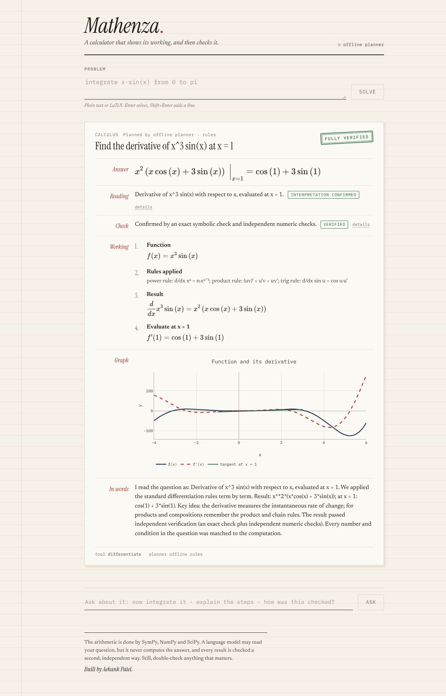

# MathForge AI

**Solve · Verify · Explain.** MathForge AI is a math reasoning app built around a
**Solver–Verifier–Tutor** workflow. An LLM (Groq) can read the problem and pick a tool. The math itself
is always done by **SymPy, NumPy and SciPy**, and a separate verifier checks every result with a
**different method** before it reaches the user.



## What it does

| Category | Examples |
|---|---|
| Algebra | `Solve x^2 - 5x + 6 = 0`, `x + 2y = 7, 3x - y = 7`, `factor x^3 - 8`, `cos(x) = x` (numeric) |
| Calculus | `derivative of x^3 sin(x)`, `second derivative of exp(x^2)`, `derivative of x^2 at x = 3`, `limit of sin(x)/x as x -> 0` |
| Integrals | `Integrate x^2 from 0 to 3`, `integral of x e^x dx`, `integrate exp(-x^2) from -oo to oo` |
| Linear algebra | `determinant / inverse / eigenvalues / rank / rref / transpose of [[…]]`, `solve [[2,1],[1,3]] x = [3,5]`, matrix products |
| Probability & statistics | `mean and standard deviation of 2, 4, 4, 5`, `Binomial n=10 p=0.5, P(X <= 3)`, `normal mean 100 std 15, P(X > 130)`, Poisson / uniform / exponential, `10 choose 3`, `P(5,2)`, `6!` |

Every solution includes:

- an **exact answer** (LaTeX, rendered with KaTeX)
- a **verification badge**: `verified`, `approximate`, `unverified` or `failed`, plus each check that was run
- **step-by-step working**, built from the actual computation
- an **interactive Plotly chart**: roots on the curve, f with f′ and a tangent line, shaded area under a curve, limit behaviour, eigenvalues in the complex plane, histograms, and shaded probability regions
- a **planner badge** showing whether the Groq LLM or the offline planner turned the question into a computation, with a
  notice whenever the app had to fall back to the offline planner (daily budget used, Groq rate limit, failed or rejected plan)
- an **explanation**: from a template by default, or written by the LLM when `LLM_EXPLANATIONS=true`
- **follow-up questions** in the same session (`now integrate it`, `explain the steps`, `how was this verified?`)

## Architecture

```
                ┌──────────────────── LangGraph StateGraph ────────────────────┐
 problem ──► plan ──► intent ──► solve ──► verify ──► explain ──► visualize ──► response
              │         │          │
              │         │          └─ tool error ───────────────────────────► error
              │         └─ ambiguous / misread (after one repair attempt) ──► needs clarification
              └─ unsupported ───────────────────────────────────────────────► not supported
```

Two separate questions are verified:

1. **Is the math right?** The independent mathematical verifier checks the tool's result.
2. **Is it the right question?** The intent verifier checks that the planned tool and arguments match what was asked.

A result is shown as **fully verified** only when both pass. If the math is verified but the reading of the question
relied on assumptions, it is shown as **verified with assumptions**, with the assumptions listed. If the question was
misread or information is missing, nothing is computed and the user is asked for clarification.

| Layer | Path | Responsibility |
|---|---|---|
| Safe parser | `backend/app/math_engine/parser.py` | Lexical allowlist (characters, identifiers, length) runs **before** SymPy sees anything. No builtins, attribute access, dunders or unknown functions. |
| Tools | `backend/app/math_engine/tools.py` | 12 whitelisted tools (`solve_equation`, `integrate`, `matrix_operation`, `probability_distribution`, …) with timeouts, input validation and generated steps |
| Verifier | `backend/app/math_engine/verifier.py` | Checks each result with a *different* method (see below) |
| Visualizer | `backend/app/math_engine/visualize.py` | Builds Plotly JSON from the computed objects |
| Planner (LLM) | `backend/app/agents/llm_planner.py` | Groq via `langchain-groq` structured output (`LLM_STRUCTURED_METHOD`: JSON schema or tool calling). Returns only a tool name and string arguments, validated by Pydantic. |
| Planner (rules) | `backend/app/agents/rule_planner.py` | Deterministic offline planner for formulaic input. Used when no key is set, and as an alternative plan. |
| Planner (NL) | `backend/app/agents/nl_planner.py` | Offline planner for word problems, built on the structured intent extraction. It asks for missing information rather than using defaults. Because it shares the extraction with the intent checker, its readings are capped at "assumed". |
| Intent verifier | `backend/app/agents/intent.py` | Extracts the intent with its own cue-based rules: task, variable, domain, order, point, bounds, limit point and direction, probability event, distribution, counting rule, matrices, data and every number. It then checks the plan: the task matches, every argument value appears in the question, every stated number is used, the slots match, and expressions are numerically equivalent to the math written in the question. Ambiguities the LLM declares are honoured. |
| Tutor | `backend/app/agents/tutor.py` | Explains the verified result without adding numbers, and answers follow-ups |
| Graph | `backend/app/agents/graph.py` | LangGraph workflow. Tries plans in order (LLM, rules, NL) until one matches the question, makes one safe repair (filling in a slot the question states, such as "positive" or "at x = 3"), and combines the math and intent statuses into the overall status. |
| API | `backend/app/main.py`, `service.py` | FastAPI: `/api/solve`, `/api/followup`, `/api/health`, `/api/examples`; in-memory LRU sessions. Calls Groq (within the budget), then hands the computation to the sandbox. |
| Sandbox | `backend/app/sandbox.py`, `jobs.py` | Pool of worker processes that run all parsing, planning checks, tools, verification and plots, with a wall-clock timeout (the worker is killed and replaced), a memory limit (`RLIMIT_AS`), no network and no secrets |
| Usage budget | `backend/app/budget.py` | Rolling 24-hour ledger of the tokens Groq actually reports, a pause after Groq 429s / exhausted quota / repeated errors, optional JSON persistence |
| Rate limits | `backend/app/ratelimit.py` | Per-client sliding windows (requests per minute and per day, and each client's daily share of Groq calls) |
| Hardening | `backend/app/security.py` | Request-size limit, security headers, secret redaction in every log record |
| UI | `frontend/` | React 19 + TypeScript + Vite, KaTeX, Plotly (loaded lazily) |

### How each result is verified

| Tool | Independent check(s) |
|---|---|
| Equations | Substitute each solution back (symbolic, then numeric residual). Separately, a SciPy `brentq` sign-change search on [-50, 50] confirms no real root was missed. |
| Systems | Substitute each solution into every equation |
| Simplify / factor / expand | Symbolic difference, plus numeric equality at random points |
| Derivatives | Central finite differences at random points, and integrating the result back |
| Integrals | Differentiate the antiderivative back to the integrand; definite integrals also checked with `scipy.integrate.quad` |
| Limits | Evaluate numerically while approaching the point from each side |
| Matrices | NumPy recomputation, `A·A⁻¹ = I`, eigenvalues as roots of the characteristic polynomial, `A·x = b` residual, Berkowitz determinant |
| Statistics / probability | NumPy / `scipy.stats` recomputation; Python integer arithmetic for combinatorics |

**Status meanings**

- `verified`: an exact check passed and every numeric check agrees.
- `approximate`: only numeric agreement was possible, for example a root found with Newton's method or a limit.
- `unverified`: no independent check applied.
- `failed`: a check disagreed. The UI shows this in red and opens the details.

The tests corrupt correct solver outputs on purpose (a wrong root, a missing root, a wrong
derivative, a wrong eigenvalue, and so on) and assert that the verifier reports `failed`.

### Safety model

- The LLM **never runs code**. It can only pick from a fixed list of tools (a `Literal` type).
  Arguments that a tool doesn't declare are rejected.
- Every expression passes the allowlist in `parser.py` before SymPy parses it. SymPy runs with an
  empty `__builtins__` and an explicit symbol table. Input like `__import__("os")`, `x.__class__`, `exec(…)`,
  quotes, `;` or `[]` inside an expression is rejected (`tests/test_parser.py`).
- Matrix and list inputs are read with `ast.literal_eval`, which accepts literals only.
- Limits on input size: problems up to 1,000 characters, expressions up to 500, matrices up to 10×10, data sets up to
  10,000 values. Inputs that are known to explode are refused before parsing: integers over 60 digits, exponents over
  1,000 (including stacked powers such as `9^9^9^9`, which mean `9^(9^(9^9))`) and factorials over 5,000.
- Everything else runs in the computation sandbox: each request gets at most `SANDBOX_TIMEOUT_SECONDS` (10 s); a worker that
  runs over is killed with its whole process group and replaced, so a runaway SymPy call cannot keep using CPU. Workers have an
  address-space limit (`SANDBOX_MEMORY_MB`, 1.5 GB), so a memory bomb fails inside the worker. Workers have no API key and never call the network.
- If the problem is ambiguous (several variables and none specified), unsupported (for example a differential
  equation), or has no solution (`x = x + 1`, a singular matrix), the app returns a clear message instead of a guess.

### Public-deployment protections

| Risk | Protection |
|---|---|
| One visitor spends the free Groq quota | Global rolling 24-hour token and request budget (`LLM_DAILY_TOKEN_BUDGET`, 150k of Groq's 200k by default), charged with the token counts Groq reports. Each client also gets a daily share of Groq calls (`LLM_CALLS_PER_CLIENT_PER_DAY`); after that they are served by the offline planner instead of being refused. |
| Groq rate limits, exhausted quota, outages | A 429 pauses the LLM until the reset time Groq states; `x-ratelimit-remaining-requests: 0` does the same, and 3 consecutive failures pause it for 2 minutes. While paused, nothing is sent to Groq and the offline planners answer. The response's `llm_status` says why (`budget`, `cooldown`, `client_quota`, `error`, `rejected`), and the UI shows a notice. |
| Request floods | Per-client limits: 10 requests a minute and 300 a day by default, answered with 429 and `Retry-After`. The pool size bounds concurrent computations, and requests that cannot get a worker within 15 s get 503 with `Retry-After`. |
| Expensive or malicious math | Static input guards plus the process sandbox (time and memory limits, kill on timeout) |
| Oversized or malformed requests | 16 KB body limit (413), strict schemas (unknown fields, control characters and malformed session ids are rejected), concise 422 errors that do not echo the input |
| Secret leaks | The key lives only in the API process environment (never in workers or responses). Every log record passes through a redaction step that masks `gsk_…` keys, bearer tokens, `api_key=` values and Groq organisation ids. Raw provider errors are never returned to the browser; unexpected errors return a generic 500. |
| Browser attacks | CORS allowlist; `nosniff`, `X-Frame-Options: DENY`, `Referrer-Policy: no-referrer`, a strict API CSP; the nginx frontend sends a CSP with no inline scripts. OpenAPI docs are off unless `ENABLE_DOCS=true`. |
| Spoofed client IPs | `X-Forwarded-For` is ignored unless `TRUSTED_PROXY_HOPS` is set, and is then read from the right (entries the proxies added), so clients cannot claim a new identity |

Run a single API process (`--workers 1`, as the Dockerfile does): the budget, rate limits and sessions are in memory.
Computation concurrency comes from `SANDBOX_WORKERS`.

## Running it

### Option 1: Docker (one command)

```bash
cp backend/.env.example .env        # optional: add a free GROQ_API_KEY
```

```bash
docker compose up --build
```

Open http://localhost:8080 for the UI. The API listens on http://localhost:8000 (local only; set `ENABLE_DOCS=true` for
the interactive docs at `/docs`).

### Option 2: Local development

Backend (Python 3.12+):

```bash
cd backend && python -m venv .venv && source .venv/bin/activate
```

```bash
pip install -r requirements-dev.txt
```

```bash
cp .env.example .env   # optional: set GROQ_API_KEY
```

```bash
uvicorn app.main:app --reload --port 8000
```

Frontend (Node 22+), in a second terminal. The Vite dev server proxies `/api` to port 8000:

```bash
cd frontend && npm install && npm run dev
```

Open http://localhost:5173.

### LLM configuration (optional, free)

| Variable | Default | Purpose |
|---|---|---|
| `GROQ_API_KEY` | *(empty)* | Free key from https://console.groq.com/keys. Without one, the deterministic planner and template explanations are used. |
| `LLM_MODEL` | `openai/gpt-oss-120b` | Any Groq chat model that supports tool calling (the default was changed after llama-3.3-70b-versatile turned out to be unavailable on the account used for testing) |
| `LLM_ENABLED` | `true` | Set to `false` to force offline mode |
| `LLM_STRUCTURED_METHOD` | `json_schema` | How the planner returns its plan: `json_schema` (Groq structured outputs) or `function_calling` (forced tool call). See "Groq reliability" below. |
| `LLM_EXPLANATIONS` | `false` | Also ask the LLM for the tutor explanation (one extra call per solved problem) |
| `LLM_MAX_RETRIES` | `1` | SDK retries for transient Groq errors |
| `LLM_DAILY_TOKEN_BUDGET` / `LLM_DAILY_REQUEST_BUDGET` | `150000` / `800` | Deployment-wide Groq budget per rolling 24 h |
| `LLM_CALLS_PER_CLIENT_PER_DAY` | `40` | Each client's share of Groq calls; beyond it the offline planner answers |
| `LLM_BUDGET_STATE_PATH` | *(unset)* | JSON file that keeps the budget ledger across restarts |
| `RATE_LIMIT_PER_MINUTE` / `RATE_LIMIT_PER_DAY` | `10` / `300` | Per-client request limits (0 disables) |
| `TRUSTED_PROXY_HOPS` | `0` | Number of reverse proxies in front of the API that append `X-Forwarded-For` (Docker Compose sets 1) |
| `SANDBOX_WORKERS` / `SANDBOX_TIMEOUT_SECONDS` / `SANDBOX_MEMORY_MB` | `2` / `10` / `1536` | Computation pool size, time limit and memory limit per worker |
| `MAX_REQUEST_BYTES` | `16384` | Request body limit |
| `ENABLE_DOCS` | `false` | Serve `/docs` and `/openapi.json` |
| `CORS_ORIGINS` | `http://localhost:5173,http://localhost:8080` | Allowed browser origins |

Never commit `.env`. It is listed in `.gitignore`.

## Testing

```bash
cd backend && pytest
```

```bash
cd frontend && npm test
```

The backend suite has 369 tests and runs fully offline (no Groq calls). It covers:

- parser security and the correctness of every tool against known answers;
- the verifier, both accepting correct results and detecting wrong ones;
- intent verification (`tests/test_intent.py`): ambiguous wording, wrong tool selection, missing constraints and misread parameters;
- the LangGraph workflow with a fake LLM, including misreadings, declared ambiguities and provider failure;
- the HTTP API, plus benchmark floors and an offline Groq replay test;
- deployment protections (`tests/test_deployment.py`, `tests/test_sandbox.py`): the rolling token budget, Groq 429 / quota
  handling and the circuit breaker, per-client limits and spoofed `X-Forwarded-For`, offline-planner notices, request validation,
  the body-size limit, security headers, secret redaction in logs and responses, and real worker processes being killed on
  timeout, stopped by the memory limit and replaced.

The frontend suite (16 tests) uses Vitest and Testing Library, including the planner badge, the offline notice, timeout and
rate-limit messages and the status legend.

CI (`.github/workflows/ci.yml`) runs ruff, pytest, oxlint, vitest and the production build. It then
builds both Docker images and smoke-tests the running stack, including a runaway computation that must be stopped,
security headers, disabled docs and the body-size limit.

## Evaluation benchmark

`backend/eval/` contains a reproducible benchmark of **378 items**:

| Part | Items | Purpose |
|---|---|---|
| Development set | 150 answerable + 29 should-refuse | All 12 tools, edge cases, ambiguous inputs, unsupported or unsafe requests |
| Held-out paraphrases (Phase 2) | 31 answerable | Natural wording, written after the Phase 2 planner was frozen |
| **Unseen real-world set (Phase 3)** | 45 answerable + 11 needing clarification | Word problems, "positive" / "real" constraints, distractor numbers, missing information. Committed in its own commit (`3c6ba6f`) before any Phase 3 change, and never used for tuning |
| NL tuning set (Phase 3) | 38 answerable + 4 needing clarification | Used to develop the Phase 3 language handling |
| Tampered solutions | 34 | Correct tool outputs corrupted, e.g. a wrong root, a missing complex root, a transposed inverse |
| Tampered interpretations | 36 | Correct plans with one misreading each, e.g. the wrong operation, swapped bounds, an invented parameter, an ignored "positive", wrong strictness, swapped n and k |

That is 308 problems (264 answerable + 44 that should be refused or clarified), plus 34 tampered solutions and 36 tampered
interpretations. Every rate in the reports is printed with its numerator and denominator. Two notes on denominators:

- `oracle` mode skips the 29 natural-language-only refusal cases, because they have no canonical tool arguments.
- Tamper controls are reported separately and are never pooled with real outputs.

Ground truth is written by hand from closed forms and definitions. `python -m eval.ground_truth` confirms all 264 answers
independently with mpmath, NumPy and SciPy, without importing application code.

```bash
cd backend && python -m eval.ground_truth
```

```bash
python -m eval.run --mode oracle   # math engine + intent checker on canonical plans
```

```bash
python -m eval.run --mode rules    # full pipeline, offline planners
```

**Results, `rules` mode**, from the committed reports in `eval/reports/`:

| | Phase 2 baseline | Intent layer only | Phase 3 first run | Phase 3 final |
|---|---|---|---|---|
| Unseen: answer accuracy | 48.9% (22/45) | 48.9% (22/45) | 93.3% (42/45) | **95.6% (43/45)** |
| Unseen: clarification when information is missing | 9/11 | 11/11 | 10/11 | **11/11** |
| Unseen: wrong answers + answered-when-should-ask | 0 + 2 | 0 + 0 | 2 + 1 | **0 + 0** |
| Held-out paraphrases: answer accuracy | 51.6% (16/31) | 51.6% | 96.8% (30/31) | **96.8% (30/31)** |
| Development set: answer / refusal accuracy | 150/150, 29/29 | same | same | **150/150, 29/29** |
| Incorrect answers presented as fully verified | n/a | 0 | 0/3 | **0** |

| Final metric (`rules`, all 308 problems) | Value |
|---|---|
| Fully-verified precision (math verified *and* intent confirmed ⇒ correct) | 100% (176/176) |
| Fully-verified recall | 67.4% (176/261). The other correct answers are shown as "verified with assumptions" or "approximate" |
| Math-verified precision / recall | 100% (231/231) / 88.5% (231/261) |
| Tampered solutions detected | 34/34 |
| Tampered interpretations flagged / valid controls wrongly flagged | 36/36 / 0/35 |
| Correct canonical plans flagged by the intent checker (`oracle`) | 0/264 |
| Latency p50 / p95 | 22 ms / 96 ms |

How these numbers were produced, and what they don't show:

- **"Phase 3 first run"** was the first evaluation on the unseen set after development. It produced 2 wrong answers and 1
  answer that should have been a question. All 3 were shown as "verified with assumptions", none as fully verified.
  Two general safety fixes followed:
  - a planned variable must occur in the expression (the planner had differentiated "with respect to f" in "for f(x) = …");
  - the NL planner may no longer default to n! when only one number is given.

  The second fix also made `unseen-11` correct, which accounts for 42 → 43. No coverage was added for the phrasings
  still refused (`unseen-40`, `unseen-41`, `para-01`).
- **The unseen set was written by the same author as the system**, so it measures generalisation beyond the tuned
  examples, but not like independent user data. The intent checker was developed against the tampered-interpretation suite, so 36/36 there is a development figure.
- **Held-out caveat.** The held-out paraphrases' failure list was visible after Phase 2. Some phenomena overlap with the NL tuning set
  ("what's", "slope at", "area under"), so the 96.8% held-out figure is less clean than the unseen figure.
- **Dataset correction.** The canonical plan for `para-03` was updated to `domain = real` after the intent checker correctly flagged that
  the Phase 2 plan ignored "real". The ground truth was not changed.

### Groq smoke test (25 questions, `openai/gpt-oss-120b`)

`llama-3.3-70b-versatile` turned out to be unavailable on the test account. `openai/gpt-oss-120b`, the largest available
model with tool calling, is now the default. Reports: `eval/reports/groq_smoke.md`, plus
`groq_smoke_run1_schema_errors.md` for the first run. These are smoke-test figures, **not** benchmark accuracy.

| | Run 1 (schema errors) | Final run |
|---|---|---|
| Groq calls that failed (HTTP 400, schema validation) | 7/25 | 2/25 |
| End-to-end answer accuracy | 19/19 | 19/19 |
| End-to-end refusal / clarification accuracy | 6/6 | 6/6 |
| Groq plans accepted by the intent check | 16/18 | 18/19 |
| Accuracy of accepted Groq plans | 15/15 | 18/18 |
| Groq tool selection (before intent check) | 16/16 | 18/18 |
| Should-refuse inputs where Groq refused or its plan was rejected | 1/6 | 5/6 |
| Should-refuse inputs where a Groq plan was accepted | 1/6¹ | 0/6 |
| Tokens (measured calls) | not recorded | 45,042 over 24 calls (~1,880 per call) |
| Groq call latency p50 / max; end-to-end p50 / p95 | n/a | 1.16 s / 1.81 s; 1.21 s / 1.83 s |

¹ `edge-05` (the inverse of a singular matrix): a faithful plan, which the math engine then correctly refused.

Run 1 failed when `gpt-oss` omitted fields the schema required (`tool` when refusing, `category`) or called a non-existent
`json` tool. In those cases the offline planners answered, and the report recorded each one as a Groq `error`.
The fixes made `tool` and `category` optional and added one retry for Groq's tool-call validation 400s.
After the final run, a remaining failure (an out-of-range `category` value) was fixed and validated with unit tests and
offline graph tests, but not re-measured against Groq. The category rules:

- a missing or unrecognisable category is derived from the tool;
- a recognisable category that contradicts the tool, in any spelling and including `unsupported`, rejects the plan;
- an executable plan without a valid tool or its required arguments never runs.

Raw planner response caches (`*cache*.jsonl`) stay on the local machine and are git-ignored. The committed reports hold
the sanitized record: structured plans, statuses, usage and truncated error messages. `--replay` needs the local cache.

### Full Groq benchmark (308 questions, `openai/gpt-oss-120b`)

Report: `eval/reports/groq_final.{json,md}`. This is the complete run, validated with the provenance check. The interim
report `groq.md` (246 questions, before the fix) and its offline re-score `groq_rescored_246.md` are kept for comparison.
The run took three sessions because the free tier allows 200,000 tokens per day on a rolling 24-hour window. About 490k
tokens over about 264 live calls; cached questions were never called twice. Pacing was 10 RPM / 6,000 TPM, and the account
limits were 1,000 requests per day and 8,000 tokens per minute.

| Question set | End-to-end answers | End-to-end refusals | Groq plans accepted | Accepted plans correct | Groq tool choice |
|---|---|---|---|---|---|
| Development (179) | 150/150 | 29/29 | 145 | 137/137 | 146/147 |
| Held-out paraphrases (31) | 30/31 | – | 29 | 29/29 | 30/30 |
| Unseen (56) | 44/45 | 11/11 | 39 | 39/39 | 40/40 |
| NL tuning (42) | 38/38 | 4/4 | 27 | 27/27 | 28/28 |
| **All 308** | **262/264** | **44/44** | **240** | **232/232** | **244/245** |

- **No wrong answers end to end.** The two missed answers are clarification requests: an all-words equation, and a ranking question ("first, second and third").
- **Fully verified ⇒ correct: 205/205.** Math-verified ⇒ correct: 232/232. Tampered solutions detected: 34/34. Tampered interpretations flagged: 36/36, with 0/35 false alarms.
- **Groq call failures: 28/308.** Ten were calls to a non-existent `json` tool, ten were plain-text replies, and eight were plans that named no tool. The offline planners handled all of them.
- **Intent-check rejections of Groq plans: 21.** Ten were an unrequested `domain=real`; seven were missing information, where asking is correct. Four were genuine misreadings: P(X > k) planned as P(X ≥ k) twice, a statistics question turned into arithmetic, and the triangle-area precomputation.
- **Latency:** Groq calls take 1.15 s typical (1.89 s at p95). End to end it's 1.19 s typical (2.0 s at p95).

### Groq reliability: tool calling vs JSON schema

The 28 Groq call failures in the full benchmark (9.1%) all came from the **tool-calling** transport, not from the plan content:

| Failure (function calling, forced tool choice) | Count | Cause |
|---|---|---|
| Call to a non-existent tool named `json` | 10 | gpt-oss sometimes routes structured output through a built-in "json" tool. Groq rejects it with HTTP 400 "tool call validation failed"; one automatic retry did not fix it. |
| Plain-text reply ("Tool choice is required, but model did not call a tool") | 10 | The model answered in prose despite the forced tool choice. Groq returns HTTP 400. |
| Valid plan that names no tool | 8 | Schema-valid but incomplete (`tool: none`). |

The planner now asks for **JSON-schema structured output** (`response_format: json_schema`, `LLM_STRUCTURED_METHOD=json_schema`, the new
default). With no tool machinery involved, the first two failure types cannot occur. The third is still possible, and it is still
rejected by the same validation, intent and provenance checks, and answered by the offline planners. Nothing about verification changed:
the JSON plan is converted into the same `ToolCall` and goes through exactly the same checks.

**Targeted re-test** (`eval/reports/groq_json_schema_retest.{json,md}`): only the 28 questions that had failed, not the full benchmark.
Groq's rolling 24-hour token limit was still nearly used up by the full benchmark, so the re-test is **partial: 6 of 28 questions** got a
real Groq response (the other attempted calls were quota 429s, recorded as errors). Of those 6, there were **0 malformed responses**:
5 plans were accepted, and the refusal on "prove that sqrt(2) is irrational" was a valid `supported=false`. The 3 answerable ones were all
answered correctly and fully verified. This sample is small. It supports the switch, but it is not a measured failure rate. Re-run the same
command when the quota allows; cached questions are not called again:

```bash
cd backend && GROQ_AUTH=proxy LLM_STRUCTURED_METHOD=json_schema python -m eval.run --mode groq --allow-network --rpm 10 --tpm 6000 --only eq-04,lin-15,comb-06,edge-05,edge-12,unsup-03,unsup-04,para-20,unseen-04,unseen-39,unseen-41,unseen-42,unseen-45,unseen-47,unseen-55,unseen-56,nl-03,nl-07,nl-17,nl-21,nl-25,nl-27,nl-29,nl-30,nl-32,nl-34,nl-39,nl-42 --cache eval/reports/groq_cache_json.jsonl --out-name groq_json_schema_retest
```

`LLM_STRUCTURED_METHOD=function_calling` restores the previous transport. Its cache keys are unchanged, so the recorded benchmark replays exactly.

### Groq planner evaluation (how to re-run)

Dry run for `openai/gpt-oss-120b` at `--rpm 10 --tpm 6000`, sending nothing:

- 308 problems, of which 24 are already cached from the smoke test, so 284 new calls;
- about 1,877 tokens per call, measured in the smoke test, so about 533k tokens in total;
- one call every 18.8 seconds, so about 90 minutes plus call latency.

Groq's free tier also has daily request and token limits per model. If a daily cap is reached, the run stops after 5 consecutive
errors with an incomplete report. Re-running the same command later resumes from the cache. Running one split at a time
(`--split dev|heldout|unseen|dev_nl`) keeps each session smaller.

No Groq results have been measured yet. Each command below that contacts Groq needs `--allow-network`.

**Credentials.** Choose one:

- Local development: `GROQ_API_KEY`.
- Cloud environments whose egress proxy injects a network secret for `api.groq.com` (Bearer token, path prefix `/openai/v1/`): set
  `GROQ_AUTH=proxy`. The SDK then sends a fixed placeholder, and the egress proxy injects the real key, which
  never enters this process.

**Order of operations**, all run from `backend/`:

1. Check authentication with a single request, `GET /openai/v1/models`, which uses no tokens:

   ```bash
   GROQ_AUTH=proxy python -m eval.groq_check --allow-network
   ```

2. Preview the 25-question smoke test (sends nothing):

   ```bash
   GROQ_AUTH=proxy python -m eval.run --mode groq --subset smoke --dry-run
   ```

3. Run the smoke test (25 planner calls, about 9 minutes at the default pacing):

   ```bash
   GROQ_AUTH=proxy python -m eval.run --mode groq --subset smoke --allow-network
   ```

4. Run the full benchmark (308 planner calls, about 2 hours at the default pacing):

   ```bash
   GROQ_AUTH=proxy python -m eval.run --mode groq --allow-network
   ```

5. Re-score from cached responses at any time, with no network:

   ```bash
   python -m eval.run --mode groq --replay
   ```

When running locally, replace `GROQ_AUTH=proxy` with `GROQ_API_KEY=...`.

**How a run behaves:**

- **Smoke subset** (`eval/smoke.py`): 25 existing benchmark questions picked by ID. It covers all 12 tools and all four splits,
  natural wording and misreading traps, plus 6 inputs that should be refused. The questions are referenced, never copied or
  changed. Its results are reported as a subset and must not be quoted as benchmark accuracy.
- **Pacing:** each planner call is about 2,150 tokens. The runner waits between uncached calls to stay within `--rpm` (default 20)
  and `--tpm` (default 6,000 tokens/min, conservative for the free tier). Raise both if your Groq limits allow.
- **Retries:** the Groq SDK retries 429 and 5xx responses `--retries` times (default 5), honouring `Retry-After`.
- **Resume:** planner responses are cached in `eval/reports/groq_cache.jsonl`, keyed by prompt version, model and question.
  Failed calls are never cached. Re-running the same command resumes, and cached questions cost nothing.
  Progress is written to `<name>.progress.jsonl` as the run goes.
- **Early stop:** after `--max-consecutive-errors` failed calls in a row (default 5), the run stops and writes a report marked incomplete.
- **Honest accounting:** if an LLM call fails, the app falls back to the offline planners, and the report records it as an
  `error`, not as an LLM result. The report separates end-to-end accuracy from LLM-only figures: plans accepted by the intent
  check, the accuracy of those accepted plans, plans rejected in favour of a faithful offline plan, plans rejected with a
  clarification request, plans the LLM itself refused, and call errors.
- **Independence:** the intent check uses only the question text. Missing, malformed or contradictory LLM plans are rejected before
  any tool runs, for example wrong types, bad enum values, a category that contradicts the tool, or an interpretation that
  contradicts the arguments. The LLM's own assumptions and ambiguities can only lower trust.

## Deployment (zero cost)

Not deployed yet. Recommended free setup, using only free tiers with no card required:

| Part | Service | Why |
|---|---|---|
| Backend (FastAPI + sandbox) | [Hugging Face Spaces](https://huggingface.co/docs/hub/en/spaces-gpus), Docker SDK, free "CPU basic" hardware | 2 vCPU and 16 GB RAM, enough for two sandbox workers with 1.5 GB limits each. The free tiers of Render or Koyeb have 512 MB RAM and 0.1 vCPU, which cannot hold SymPy, SciPy and two workers. Store the key as a Space **secret** (`GROQ_API_KEY`); it is never in the image or the repository. |
| Frontend (static build) | GitHub Pages or Cloudflare Pages | Free static hosting with HTTPS. Build with `VITE_API_URL=https://<space>.hf.space`, and add that Pages origin to `CORS_ORIGINS`. |
| LLM | Groq free tier (`openai/gpt-oss-120b`) | The app's budget (150k tokens per rolling 24 h, about 75–80 planned questions) stays under Groq's 200k limit; after that, the offline planner answers. |

Notes for that setup:

- The free Space sleeps after a long idle period (about 48 hours, per the Hugging Face docs) and wakes on the next visit, which takes about a minute. Its disk is ephemeral: sessions and the budget ledger reset when it restarts. The budget is conservative, so a reset cannot push usage past Groq's own limit; Groq's 429s still pause the planner.
- Set `TRUSTED_PROXY_HOPS=1` behind the Space proxy (check the logged client addresses after the first deploy), keep `--workers 1`, and leave `ENABLE_DOCS=false`.
- Persistence is not required: no database, user accounts or stored problems.

## Known limitations / roadmap

- No inequalities, ODEs, series or multivariable calculus yet. Requests for these are reported as unsupported.
- Sessions, rate limits and the token budget are kept in memory in a single API process. They reset on restart
  (the budget can be persisted with `LLM_BUDGET_STATE_PATH`), and running several replicas would need a shared store such as Redis.
- Rate limits are per IP address. Visitors behind one shared NAT share a limit, and someone with many addresses gets
  several limits. The global Groq budget still caps the total cost at zero.
- The sandbox's memory limit is an address-space limit (`RLIMIT_AS`). It works on Linux (the Docker image) and is skipped on
  platforms without it.
- The offline planners cover common phrasings and typical word problems. They still refuse equations written entirely in words
  ("x squared minus 9 equals 0"), ordinal rankings ("first, second and third") and hyphenated counts ("5-card hands").
- Intent verification is cue-based. It checks the plan against what the text says; it does not truly understand the text.
  A misreading that is consistent with every stated number and cue can pass as "assumed". That status is never shown as fully verified.
- CI never calls Groq. LLM planning is covered by mocked tests, offline replays and the measured benchmark reports.
- Approximate numeric roots come from multi-start Newton search on [-10, 10]. Roots outside that range can be missed.
  The verifier's [-50, 50] sweep then reports `failed`.
- Periodic equations report real solutions only. The period may not be the minimal one, for example 2π for sin²x.
- Next steps: add an independent LLM intent judge as a second check on LLM plans,
  and collect real user questions for a truly external evaluation set.
